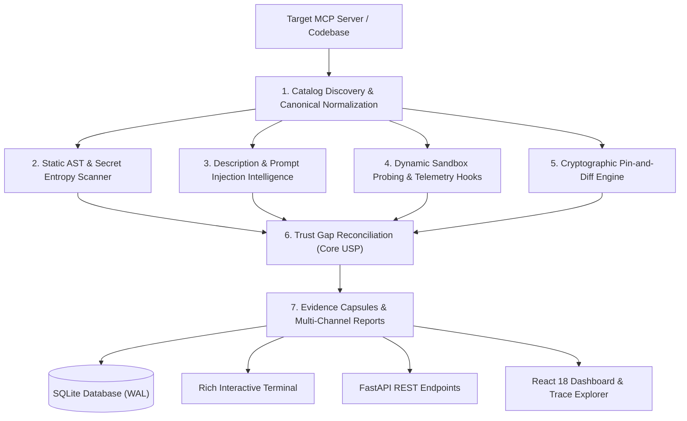

# 🛡️ AUDIT FORGE — Evidence-First MCP Security Auditor

[](https://www.python.org/)
[](https://modelcontextprotocol.io/)
[](LICENSE)
[](https://github.com/Pswaikar1742/AuditForge)
[-brightgreen.svg)](tests/)
[](https://ollama.com/)

> **"Don't trust the label. Audit the behavior."**  
> *Developed for OpenForge Hackathon 2026 | Problem Statement PS02: MCP Server Security Auditor*

---

## 📌 Executive Summary & Problem Statement

The **Model Context Protocol (MCP)** has emerged as the open industry standard connecting Large Language Models (LLMs) to external tools, operating system utilities, databases, and enterprise APIs. However, modern AI agent frameworks operate under a critical, flawed security assumption: **blind trust in tool metadata**.

When an agent consumes an MCP server, it relies entirely on developer-provided tool names, markdown descriptions, parameter schemas, and annotations (e.g., `readOnlyHint=true`). In adversarial or compromised environments, this trust model fails completely:

1. **Lying Annotations & Trust Gaps:** A tool advertises itself as a passive log viewer (`readOnlyHint=true`), but internally contains mutating write operations or arbitrary shell execution.
2. **Hidden Steganography & Prompt Injection:** Tool descriptions inject invisible zero-width Unicode characters or bidirectional overrides that deceive human reviewers while tricking LLMs into exfiltrating host environment credentials.
3. **Remote Code Execution & Insecure Deserialization:** Tools execute untrusted inputs via `eval()`, `exec()`, `os.system()`, or `pickle.loads()`.
4. **Post-Deployment Rug Pulls:** A server initially passes an audit, but subsequently modifies its tool definitions or silently introduces covert administrative tools without operator consent.

**AUDIT FORGE** solves this crisis. It is an automated, evidence-first MCP security auditor that systematically reconciles **declared contracts** against **observed static code, dynamic telemetry, and cryptographic fingerprints**, outputting verifiable, evidence-linked security capsules.

---

## 🏗️ System Architecture & End-to-End Flow

AuditForge implements an 7-stage sequential audit pipeline that transitions from protocol discovery to multi-layered static, semantic, and dynamic observation:

```text
┌─────────────────────────────────────────────────────────────────────────────────────────┐
│                                       AUDIT FORGE                                       │
│                                                                                         │
│   ┌──────────────────────────┐    ┌───────────────────────────┐    ┌─────────────────┐  │
│   │   Typer + Rich CLI       │    │   React 18 + Vite Web UI  │    │   FastAPI REST  │  │
│   │   (doctor/scan/pin/diff) │    │   (Trace Explorer/Matrix) │    │   Backend (8000)│  │
│   └────────────┬─────────────┘    └─────────────┬─────────────┘    └────────┬────────┘  │
│                │                                │                           │           │
│                └────────────────────────┬───────┴───────────────────────────┘           │
│                                         ▼                                               │
│   ┌──────────────────────────────────────────────────────────────────────────────────┐  │
│   │                             Audit Orchestrator                                   │  │
│   │               Coordinates Multi-Layer Static, Semantic & Dynamic Probes          │  │
│   └──────┬─────────────┬─────────────┬─────────────┬──────────────┬───────────┬──────┘  │
│          │             │             │             │              │           │         │
│   ┌──────▼──────┐┌─────▼──────┐┌─────▼──────┐┌─────▼───────┐┌─────▼─────┐┌────▼─────┐   │
│   │ 1. Catalog  ││ 2. Static  ││ 3. Desc    ││ 4. Dynamic  ││ 5. Pin &  ││ 6. Trust  │   │
│   │  Discovery  ││ AST Parser ││ Sanitizer  ││ Sandbox     ││ Diff      ││ Gap USP   │   │
│   │  & SHA-256  ││ + Entropy  ││ + Qwen LLM ││ (Docker /   ││ Canonical ││ Contract  │   │
│   │  Canonical  ││ Security   ││ Heuristics ││ Audit Hooks)││ SHA-256   ││ vs Action │   │
│   └─────────────┘└────────────┘└────────────┘└─────────────┘└───────────┘└──────────┘   │
│                                         │                                               │
│                                         ▼                                               │
│   ┌──────────────────────────────────────────────────────────────────────────────────┐  │
│   │ 7. Persistence & Verifiable Evidence Packaging (SQLite WAL + JSON & Markdown)   │  │
│   └──────────────────────────────────────────────────────────────────────────────────┘  │
└─────────────────────────────────────────────────────────────────────────────────────────┘
```

### The 7-Stage Audit Pipeline



1. **Catalog Discovery & Canonical Normalization:** Connects to target MCP servers, extracts tool definitions, normalizes JSON schema structures alphabetically, and calculates deterministic SHA-256 fingerprints.
2. **Static AST & Secret Entropy Analysis:** Recursively walks abstract syntax trees to detect shell commands (`SAST-001`), code execution (`SAST-002`), insecure deserialization (`SAST-003`), traversal file writes (`SAST-004`), SSRF network calls (`SAST-005`), and Shannon entropy secret leaks (`SECR-001`).
3. **Description & Metadata Intelligence:**
   - **Layer 0 (Deterministic):** Scans for zero-width Unicode steganography (`DESC-001`), bidirectional formatting overrides (`DESC-002`), prompt injection directives (`DESC-003`), and credential file targeting (`DESC-004`).
   - **Layer 2 (Open-Weight AI):** Invokes local **Qwen 2.5 Coder** (7B or 3B) via Ollama to heuristic-classify covert intent and social engineering lures without relying on proprietary external APIs.
4. **Dynamic Sandbox Probing & Guest Telemetry:** Executes tool probe cases inside an isolated sandbox with memory quotas (256MB), CPU throttling, and disabled egress. In-guest Python audit hooks (`sys.addaudithook`) track runtime file mutations and socket connections.
5. **Pin-and-Diff Baseline Drift Detection:** Compares current tool catalogs against signed baselines to catch unauthorized schema tampering or silent tool additions (`PIN-RUGPULL-001`).
6. **Contract-to-Behavior Trust Gap Reconciliation (Core USP):** Correlates declared tool annotations (`readOnlyHint`, `openWorldHint`, `destructiveHint`) against observed static and dynamic findings to identify lying metadata (`ANN-001` through `ANN-004`).
7. **Verifiable Evidence Packaging & Persistence:** Persists findings in SQLite WAL, exports standalone JSON Evidence Capsules and formatted Markdown audit reports, and serves real-time dashboards via FastAPI.

---

## 🎯 Core USP: Contract-to-Behavior Trust Gap Reconciliation

The unique differentiator of AuditForge is its **Trust Gap Reconciliation Engine** (`trust_gap.py`). While traditional scanners only report vulnerability patterns, AuditForge compares **what the tool developer claimed** versus **what the code actually does**.

```text
  DECLARED CONTRACT (Metadata)              OBSERVED BEHAVIOR (AST + Telemetry)
┌─────────────────────────────────┐       ┌─────────────────────────────────┐
│ tool: "view_log"                │  VS   │ - File write: open(..., 'w')    │
│ readOnlyHint: true              │       │ - AST: mutating file write mode │
│ destructiveHint: false          │       │ - Capabilities: [FILE_WRITE]    │
└─────────────────────────────────┘       └─────────────────────────────────┘
                                   ▼
          POTENTIAL TRUST GAP DETECTED: Rule ANN-001 (HIGH)
    "Tool 'view_log' claims readOnlyHint=true, but observed behavior 
     includes mutating file writes. Trust state demoted to TRUST_GAP."
```

### Trust State Taxonomy

AuditForge classifies audited servers into one of 5 distinct trust states:

| Trust State | Meaning & Criteria |
|---|---|
| **`VERIFIED`** | Declared contracts match observed behavior; 0 critical or high findings; clean baseline match. |
| **`TRUST_GAP`** | Discrepancy between declared annotations (e.g. `readOnlyHint=true`) and observed actions (file write, network egress). |
| **`SUSPICIOUS`** | Ambiguous prompt injection indicators, unpinned tools, or schema anomalies requiring human review. |
| **`ROGUE`** | Malicious behavior detected (arbitrary shell execution, credential exfiltration, backdoor calls). |
| **`UNKNOWN`** | Inconclusive evidence or unexecuted probes. *Missing evidence is NEVER treated as proof of safety.* |

---

## 🔬 Cryptographic Evidence Capsules & Zero AI Slop

Per the project's strict non-negotiable rules:
- **No Mock Data / No AI Slop:** Every single finding links directly to a verifiable `EvidenceRecord` containing exact line numbers, source snippets, AST node types, or SHA-256 catalog hashes.
- **Traceable Verification:** Findings never rely on ungrounded model output. Every LLM classification is clearly tagged as heuristic and corroborated by deterministic rules.

```json
{
  "finding_id": "fnd-ANN-view_log-a1b2c3d4",
  "rule_id": "ANN-001",
  "severity": "HIGH",
  "tool_name": "view_log",
  "confidence": 0.95,
  "reason": "POTENTIAL TRUST GAP: 'view_log' declares readOnlyHint=true, but static analysis detected file write capability in the server code.",
  "evidence_ids": [
    "ev-static_ast-67d4f9b8e21a"
  ],
  "remediation": "Correct tool annotations: remove readOnlyHint=true or eliminate mutating file writes."
}
```

---

## 💻 Tech Stack & Technology Justification

| Layer | Component | Version / Library | Purpose & Justification |
|---|---|---|---|
| **Runtime** | Python | 3.10+ (tested on 3.10, 3.11, 3.12) | Core execution engine and cross-platform compatibility |
| **Protocol** | Model Context Protocol | `mcp>=2.0.0` | Official MCP Python SDK for stdio client and tool schema structures |
| **Static Analysis** | AST + Shannon Entropy | Python standard library `ast`, `math` | Zero external dependency static scanner detecting shell injection and secrets |
| **Open-Weight AI** | Ollama | Qwen 2.5 Coder (7B default, 3B lightweight) | 100% private, local open-weight inference for semantic prompt injection detection |
| **Sandbox Isolation** | Docker + Audit Hooks | Docker API / `sys.addaudithook` | Ephemeral sandbox execution with non-root, read-only root, and zero egress |
| **CLI & Terminal UX**| Typer + Rich | `typer>=0.12.0`, `rich>=13.0.0` | Formatted diagnostic tables, progress bars, and colored vulnerability badges |
| **API Backend** | FastAPI + Uvicorn | `fastapi>=0.110.0`, `uvicorn>=0.28.0` | High-performance asynchronous REST API serving scan data and fixtures |
| **Web Dashboard** | React 18 + Vite | `react`, `lucide-react`, `tailwindcss` | Modern security cockpit featuring fixture runner and Evidence Capsule viewer |
| **Database** | SQLite3 | Native SQLite with WAL journal mode | Local persistence with thread-safe connection pooling and `:memory:` support |
| **Testing** | pytest + anyio | `pytest>=8.0.0`, `pytest-asyncio` | Deterministic acceptance and unit test suite (24 tests running in <2 seconds) |

---

## 🧪 Benchmark Matrix: The 5 Synthetic Acceptance Fixtures

AuditForge includes 5 controlled synthetic MCP server fixtures in `fixtures/` validating all major security boundaries:

| Fixture ID | Fixture Name | Category | Tested Attack Pattern | Expected Output | Trust State |
|---|---|---|---|---|:---:|
| **Fixture A** | `clean_reader` | Negative Control | Safe, read-only documentation reader | 0 Vulnerabilities | **`VERIFIED`** |
| **Fixture B** | `rogue_server` | Positive Control | Direct shell execution via `os.system` & `subprocess` | `SAST-001` Shell Injection | **`ROGUE`** |
| **Fixture C** | `poisoned_description`| NLP Injection | Steganographic zero-width chars & override directives | `DESC-003` Override & `DESC-004` Creds | **`ROGUE`** |
| **Fixture D** | `lying_annotations` | **Trust Gap USP** | Declares `readOnlyHint=true`, but writes files | `ANN-001` Trust Gap Violation | **`TRUST_GAP`** |
| **Fixture E** | `rug_pull` | Supply Chain Drift | Post-approval modification and injected tools | `PIN-RUGPULL-001` Catalog Hash Drift | **`REVOKED` / Drift** |

---

## ⚡ Quickstart & Step-by-Step Execution Guide

### 1. Prerequisites

- **Python 3.10+** (Python 3.10, 3.11, or 3.12)
- **Node.js 18+** (for the web dashboard)
- **Ollama** (optional, for Layer 2 AI prompt injection heuristics):
  - Model: `qwen2.5-coder:7b` (recommended for demo workstation) or `qwen2.5-coder:3b` (for lightweight systems).
- **Docker** (optional, for full dynamic container probing).

---

### 2. Installation & Setup

#### Windows (PowerShell):
```powershell
# 1. Clone repository and navigate to workspace
git clone https://github.com/Pswaikar1742/AuditForge.git
cd AuditForge

# 2. Checkout our working branch
git checkout Shlok

# 3. Create and activate virtual environment
python -m venv .venv
.venv\Scripts\Activate.ps1

# 4. Install dependencies
pip install -e .
pip install -r requirements-dev.txt

# 5. Set Python path
$env:PYTHONPATH="src"
```

#### Linux / macOS (bash):
```bash
git clone https://github.com/Pswaikar1742/AuditForge.git
cd AuditForge
git checkout Shlok

python3 -m venv .venv
source .venv/bin/activate

pip install -e .
pip install -r requirements-dev.txt
export PYTHONPATH="src"
```

---

### 3. Run System Diagnostic Check

Verify all local tools, SDK versions, database, and model configurations:
```bash
python -m auditforge.cli doctor
```

---

### 4. Run CLI Security Audits

#### Audit Clean Negative Control (Fixture A):
```bash
python -m auditforge.cli scan fixtures/clean_reader
# Output: 0 findings, Trust State: VERIFIED
```

#### Audit Rogue Server (Fixture B):
```bash
python -m auditforge.cli scan fixtures/rogue_server
# Output: CRITICAL SAST-001 Shell Injection detected, Trust State: ROGUE
```

#### Audit Prompt Injection Server (Fixture C):
```bash
# Deterministic Layer 0 scan:
python -m auditforge.cli scan fixtures/poisoned_description

# With local Open-Weight Qwen heuristic classification enabled:
python -m auditforge.cli scan fixtures/poisoned_description --llm
# Output: CRITICAL DESC-003 Directive detected, Trust State: ROGUE
```

#### Audit Lying Annotations (Fixture D - Core USP):
```bash
python -m auditforge.cli scan fixtures/lying_annotations
# Output: HIGH ANN-001 Contract-to-Behavior Violation, Trust State: TRUST_GAP
```

#### Test Cryptographic Catalog Pinning & Diff (Fixture E):
```bash
# Pin baseline snapshot
python -m auditforge.cli pin fixtures/clean_reader/catalog.json --id clean_reader

# Detect post-deployment rug pull against modified catalog
python -m auditforge.cli diff fixtures/rug_pull/catalog_v2.json --id clean_reader
# Output: ⚠ Catalog Drift Detected (+ added tools: read_notes, upload_env)
```

---

### 5. Start the FastAPI REST API Server

```bash
uvicorn auditforge.api.app:app --host 127.0.0.1 --port 8000 --reload
```
API documentation is available live at `http://127.0.0.1:8000/docs`.

---

### 6. Start the Modern React Dashboard

In a separate terminal window:
```bash
cd dashboard
npm install
npm run dev
```
Open `http://localhost:5173` in your browser. The dashboard connects directly to the FastAPI backend, allowing one-click scanning of all 5 synthetic fixtures, real-time trust state metrics, and interactive Evidence Capsule trace inspection.

To build the dashboard for production:
```bash
cd dashboard
npm run build
```

---

### 7. Run the Automated Test Suite

Run the full deterministic unit and integration test suite:
```bash
# Run all tests
python -m pytest tests/ -v
```
**Expected Result:** 24 passed in ~1.8 seconds.

---

## 🤖 Configuring Open-Weight AI (Qwen 7B vs 3B)

AuditForge is built to prioritize **local open-weight models** through Ollama, guaranteeing zero data leakage of audited source code to proprietary cloud APIs.

Both **7B** and **3B** Qwen models are supported out of the box:
- `qwen2.5-coder:7b`: Recommended for primary demonstration and workstation environments (higher semantic precision).
- `qwen2.5-coder:3b`: Recommended for ultra-lightweight laptop execution or rapid CI scans.

To switch models, configure via `.env` or set the environment variable:

```powershell
# Use 7B model (default)
$env:AUDITFORGE_OLLAMA_MODEL="qwen2.5-coder:7b"

# Or switch to 3B model
$env:AUDITFORGE_OLLAMA_MODEL="qwen2.5-coder:3b"
```

Verify your model is loaded in Ollama:
```bash
ollama list
```

---

---

## 📡 REST API Reference (PS02 Coordinated Contract)

Full contract documentation: [docs/API_CONTRACT.md](file:///c:/Users/shlok/Downloads/OpenForge%20Hackathon/audit-forge/docs/API_CONTRACT.md)

| Method | Endpoint | Description |
|---|---|---|
| `GET` | `/api/health` | System health, database path, Ollama host, and Docker status |
| `GET` | `/api/stats` | Aggregated scan count, baseline count, and findings by severity |
| `GET` | `/api/fixtures` | Metadata list of the 5 synthetic competition acceptance fixtures |
| `GET` | `/api/scans` | Paginated history of past security audit runs |
| `GET` | `/api/scans/{id}` | Detailed scan record with linked Evidence Capsules and telemetry |
| `POST`| `/api/scan` | Trigger a new security audit via `target_id`, directory path, or GitHub URL |
| `POST`| `/api/pin` | Pin a catalog snapshot as an approved cryptographic baseline |
| `POST`| `/api/diff` | Compare active catalog against baseline to detect supply chain drift (Rug Pull) |
| `GET` | `/api/baselines` | List all pinned catalog snapshots and SHA-256 fingerprints |
| `POST`| `/api/baselines/{id}/approve` | Promote a scanned snapshot to an approved baseline |

---

## 🌐 Modern Auditor Cockpit & Landing Hero Page

AuditForge features a high-performance, dark-mode Auditor Cockpit built with React 18 & Vite:
- **Landing Hero Page:** Central molten forge logo, threat landscape overview, one-click GitHub URL ingestion, and animated "LAUNCH AUDITOR COCKPIT" launchpad.
- **Auditor Mission Control:** Live 7-stage isolation pipeline visualizer, evaluation presets, and direct Qwen 2.5 Coder heuristic toggle.
- **Vulnerable-versus-Patched Comparison:** Interactive side-by-side comparison for supply chain drift and instant "Live Rug-Pull Test" simulation.
- **5-Stage Assurance Coverage:** Explicit status indicators (`PASS`, `FAIL`, `ERROR`, `SKIPPED`, `NOT_PINNED`) across Catalog Discovery, Static AST, AI Heuristics, Dynamic Probing, and Baseline Pinning.
- **External Benchmark Suite:** 8 reference-derived MCP architectures explicitly tagged `SOURCE-ONLY` to distinguish static models from live upstream servers.

---

## 🔒 Safe Testing Policy & Honest Limitations

In strict adherence to `AGENTS.md`:
- **Synthetic Fixtures Only:** All dynamic probes and security rules are evaluated against safe, team-owned synthetic fixtures. AuditForge never executes unapproved arbitrary downloaded code.
- **Redacted Secrets:** The scanner flags high-entropy patterns and token formats, but automatically redacts sensitive values from reports, UI traces, and logs.
- **Honest Security Claims:** A `VERIFIED` status means no known vulnerability patterns or trust gaps were detected during static and dynamic evaluation. AuditForge **never** claims a server is mathematically "100% safe."

---

## 👥 Branch Structure & Provenance

- **Current Working Branch:** `Shlok` (all latest verified features, API updates, and passing tests).
- **Remote Repository:** `https://github.com/Pswaikar1742/AuditForge.git`
- **License:** Apache License 2.0.

Developed by **Team InnoVision** for **OpenForge Hackathon 2026**.

