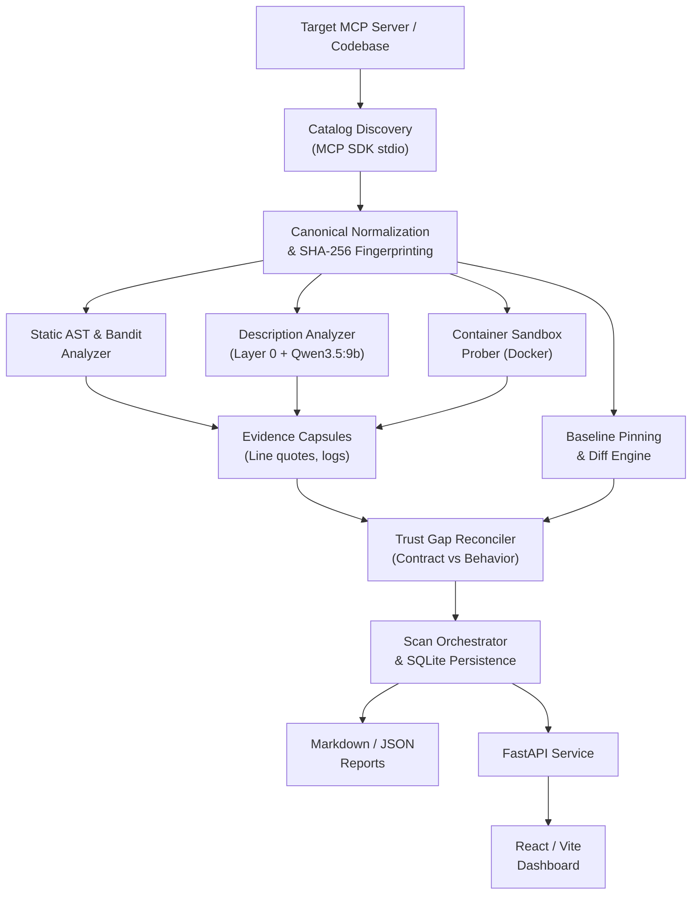

# AUDITFORGE SYSTEM ARCHITECTURE & TRUST MODEL

## 1. Executive Architectural Overview

AuditForge is an evidence-first security auditor for Model Context Protocol (MCP) servers. Its core architecture enforces a pipeline that transitions from protocol discovery to multi-layered static, semantic, and dynamic observation, culminating in contract-to-behavior trust gap analysis and verifiable evidence packaging.

---

## 2. The 6-Stage Audit Pipeline

### Stage 1: MCP Protocol Discovery & Normalization
- Connects to the server over stdio transport using `mcp.stdio_client`.
- Queries the tool list (`tools/list`).
- Normalizes JSON Schemas to canonical representation (sorting keys, resolving type aliases).
- Computes SHA-256 cryptographic fingerprints for each tool definition and the combined catalog.

### Stage 2: Static AST & Bandit Analysis
- Analyzes server source files without executing them.
- Visits AST nodes to detect dangerous standard library calls:
  - Subprocess execution (`subprocess.Popen`, `os.system`, `pty`).
  - Arbitrary file writes (`open(..., 'w')`, `shutil.rmtree`, `os.remove`).
  - Network egress (`socket`, `urllib`, `requests`, `httpx`).
  - Dynamic evaluation (`eval`, `exec`).
- Runs Bandit checks for established security patterns.
- Emits line numbers and exact code slices as `EvidenceRecord` items.

### Stage 3: Semantic Description Intelligence
- Evaluates declared tool descriptions and annotations.
- **Layer 0 (Deterministic):** Heuristic scans for prompt injection delimiters (`<IMPORTANT>`, `System:`, `Ignore prior instructions`), exfiltration instructions, and markdown disguised payloads.
- **Layer 1 & 2 (Open-Weight AI):** Uses local **Qwen3.5:9b** (fallback **Llama3.2**) through Ollama to classify covert intent, excessive tool permissions, and social engineering lures.
- Emits verbatim prompt quotes as evidence.

### Stage 4: Isolated Container Dynamic Probing
- Executes tools inside an unprivileged Docker container.
- Generates safe, schema-valid input arguments.
- Enforces hard container limits: 256MB RAM, 50% CPU quota, no network access (`network_mode="none"`), non-root user.
- Employs in-guest Python audit hooks (`sys.addaudithook`) to capture internal file and socket attempts as telemetry.
- Emits structured `ProbeOutcome` and telemetry logs.

### Stage 5: Contract-to-Behavior Trust Gap Reconciliation
- Directly compares what the tool claims versus what it actually does:
  - Claimed: `readOnly=True` in annotations.
  - Observed: `os.remove()` in AST or file modification in sandbox.
  - Evaluation: **`TRUST_GAP`** / **`ROGUE`**.
- Evaluates baseline diffs to detect rug pulls or unauthorized post-deployment changes.

### Stage 6: Persistence & Verifiable Evidence Packaging
- Saves all findings, evidence records, and snapshots into SQLite.
- Exports standalone JSON Evidence Capsules and executive Markdown reports.
- Serves data via FastAPI REST endpoints to the React/Vite dashboard.

---

## 3. Trust Boundaries & Data Ownership

| Boundary | Untrusted Zone | Trusted Enforcement Zone | Boundary Mechanism |
|---|---|---|---|
| **Host vs Probe Target** | Target MCP server code and execution | Host system & Auditor | Docker container namespaces, seccomp profile, read-only rootfs |
| **Model Intelligence** | LLM responses & prompt injections | Classification parser & logic | Local Open-Weight Ollama inference; strict JSON schema parsing |
| **Server Claims vs Facts** | Server docstrings & annotations | Frozen contracts & fingerprints | Canonical JSON serialization, SHA-256 cryptographic hashes |
| **Multi-Agent Git Work** | Agent feature implementations | Master baseline & integration | Worktrees, branch isolation, interface freeze in `contracts.py` |

---

## 4. Hardware Sizing & Resource Allocation (Platform Constraints)

- **Target Machine:** Intel i7-11800H (8 cores / 16 threads), 16 GB RAM, NVIDIA RTX 3060 Mobile (6 GB VRAM), Nobara Linux 44.
- **Model Selection:** Local Qwen3.5:9b fits in 6GB VRAM at 4-bit quant (`Q4_K_M` ~6.5GB total, offloading layers to system RAM if needed) or ultra-fast Llama3.2:3b (~2.0GB VRAM).
- **Docker Footprint:** Probing containers are strictly ephemeral and single-threaded, capped at 256MB to avoid system RAM exhaustion.
- **Dashboard:** Vite dev server runs locally on port 3000 / 5173 with negligible RAM footprint.
